# Administrator walkthrough (about 35 minutes)

You are the **administrator**: you look after all shops, their plans, the places, the prices of ads and anything that needs a decision.

Sign in at <http://localhost:3000> with `demo-admin@bannerai.demo` / `Demo-Admin-2026!`.
(New to the demo? Start with [Start here](../start-here.md).)

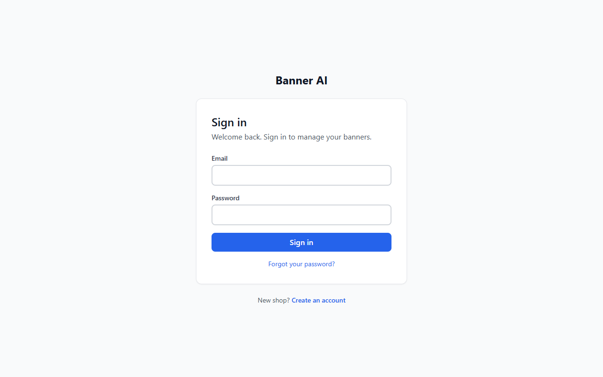

---

## Step 1. Home and the menu
The menu: *Home, Ads, Takeover, Shops, Places, Ad rates, Ad report, Plans, Subscriptions, Users, Admins, Providers, Activity*. The bell is yours too.
This walkthrough covers every item except two that are left out of the demo on purpose: **Admins** (adding administrators and asking for one to be removed; the Super Admin decides on removals) and
**Providers** (connecting outside services). Both are described in the [Administrator Guide](../admin.md).

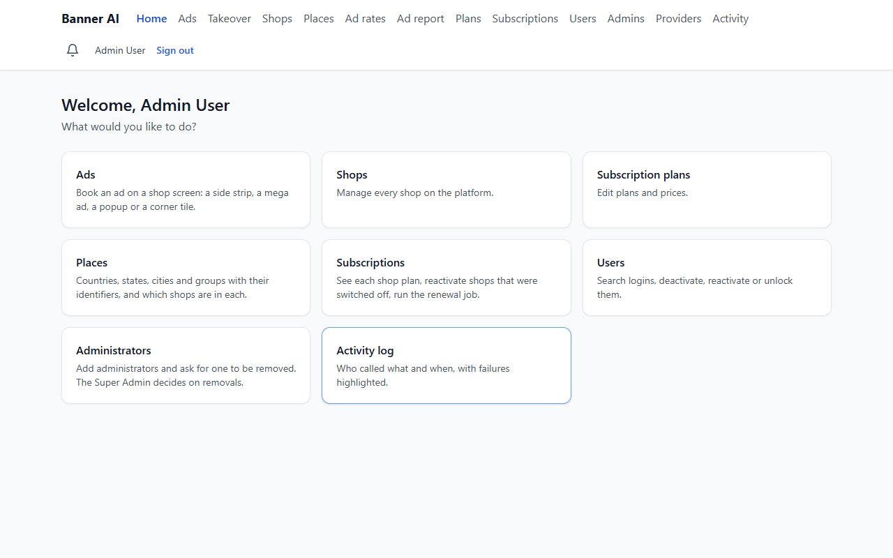

## Step 2. Users
Click **Users**. Every login with its role. Type in **Search** (name or e-mail; the picture shows `demo-`) to narrow the list, and tick **Include deactivated** to see switched-off logins. For each login:
**Activity** shows what that person did, **Reset two-step** clears their two-step sign-in when they lost their phone and their recovery codes, **Deactivate / Activate** switches the login off or on,
**Unlock** appears when a login is locked (after five wrong passwords), **Move** sends a sales executive to another shop, and **Make owner** makes a member of a shop its owner.
The yellow **Email not verified** mark shows next to demo logins; it does not stop them signing in.

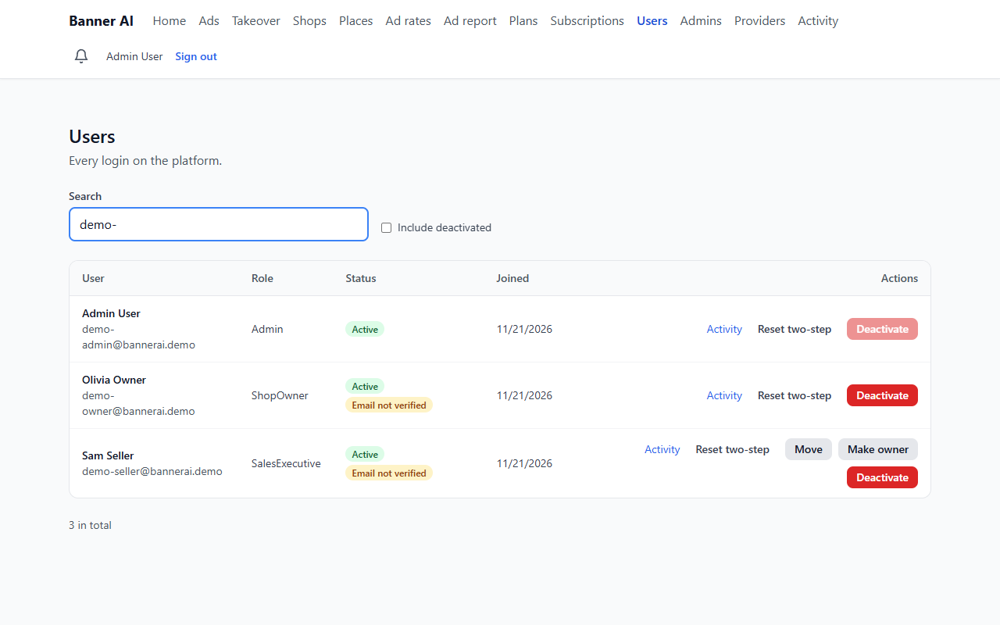

## Step 3. Subscriptions
Click **Subscriptions**. Each shop's plan, billing period and price, status and renewal date, soonest renewal first. Filter by **Status** (for example *Grace period* or *Expired*) or by **Shop** name.
**Renew early** renews a shop for another period at once, and **Run renewal job now** applies renewals, grace and expiry for every shop at once (it also runs by itself every day).
A shop whose plan has ended cannot sign in; its screen keeps the default board.

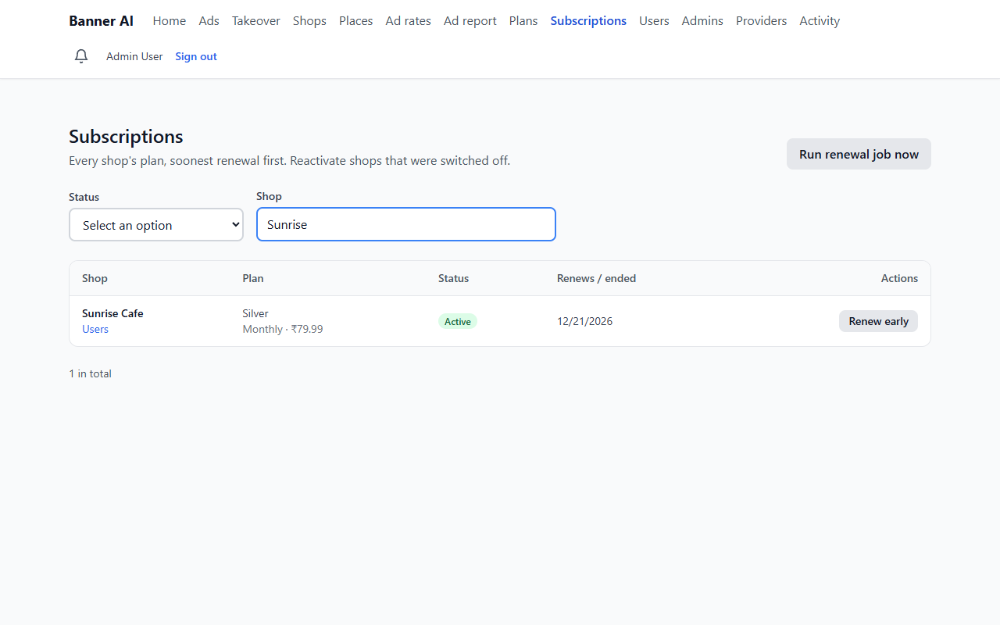

## Step 4. Plans
Click **Plans**. Basic, Silver, Gold, Platinum, each with a monthly and an annual price. **View** shows the limits of a plan (banners, shops, users and **storage**), **Edit** changes them, **Deactivate**
retires a plan, and **New Plan** makes another. A plan that shops are subscribed to keeps its price: make a new plan for a new price.

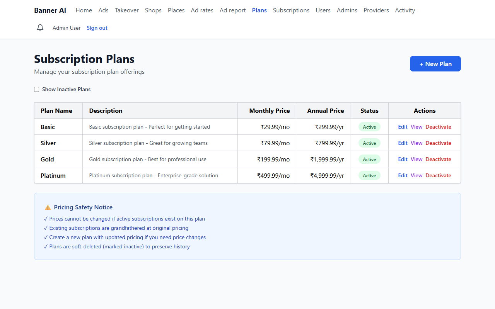

## Step 5. Shops
Click **Shops**. Every shop on the platform as a card, with **View**, **Edit** and **Deactivate**, and **Create Shop** for a new one. The filter shows *All*, *Active* or *Inactive*, and the cards come six to a page in name order (**Previous** / **Next** at the bottom). (Besides
Sunrise Cafe the list holds the platform's own *System Shop*, which belongs to the platform itself.)

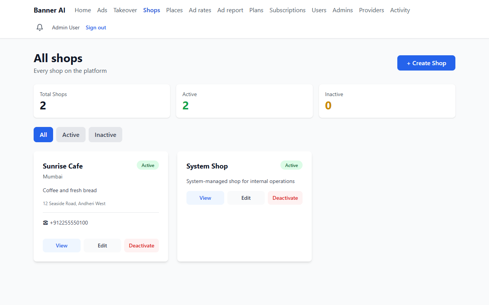

## Step 6. Places
Click **Places**. Click **India**, then **Maharashtra**, then **Mumbai**: you see its **groups** (Andheri). Add, rename or switch off places; a place that has shops cannot be deleted.
Set a **time zone** on a country or city: shops follow it unless they set their own.

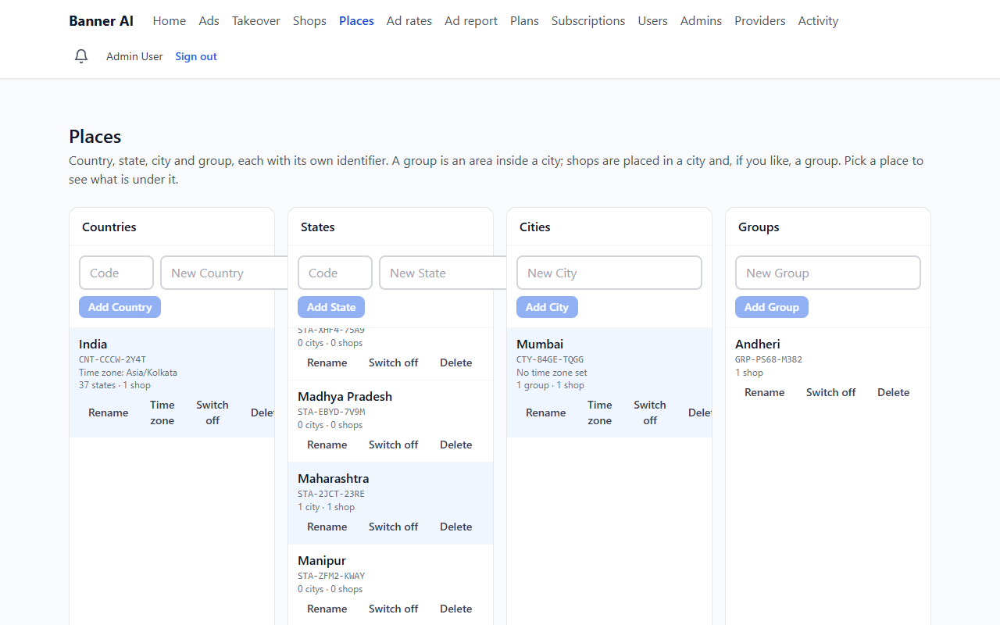

## Step 7. Ad prices
Click **Ad rates**. One rate exists: *every shop, every kind, 100 an hour, 70% paid to the shop*.
1. Click **Add a rate**.
2. Choose where it applies (empty = every shop; or a country, state, city), the kind of ad, the **price for one hour** and the **shop's share**.
3. The **narrowest place wins**: a Mumbai rate beats an India rate. Side and mega ads are priced for the whole screen and cut down to the share they take.

An ad you book cannot be sent in until a rate covers its shop.

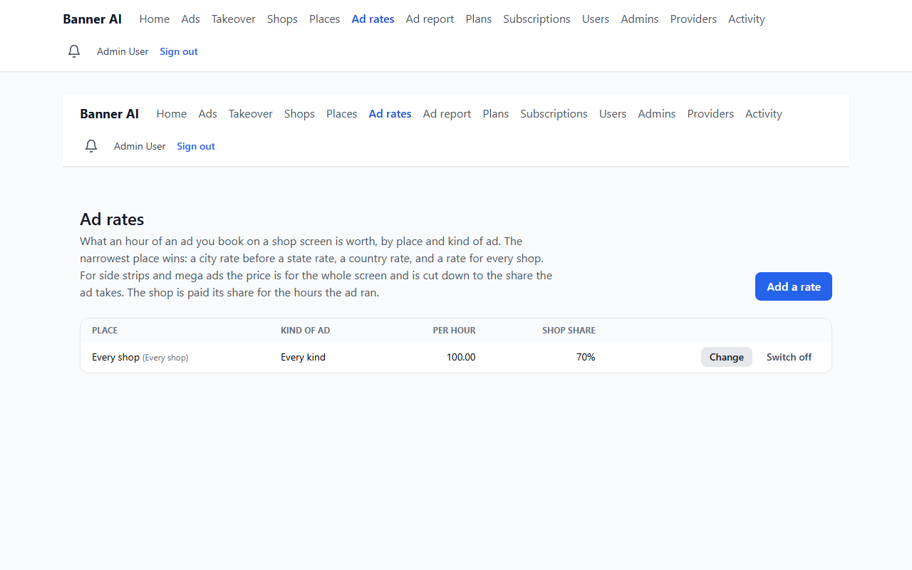

## Step 8. Book an ad on a shop
Click **Ads**, choose **Sunrise Cafe** in the *Shop* list. You see **every** ad on that shop, including the owner's and the executive's (marked "Booked by…"), so you can plan around them.
Click **Book an ad**, fill it in, **Save as draft**, **Send in**: yours are approved at once, the owner is told, and the price is fixed from the rate.

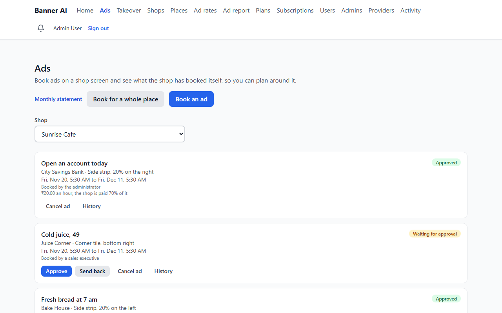

## Step 9. Book one ad on a whole city
Click **Book for a whole place**, choose **Mumbai**, fill in the ad and press **Book on all these shops**. BannerAI books each shop at its own rate and lists the shops where the ad could
not go and why (screen already taken, no rate).

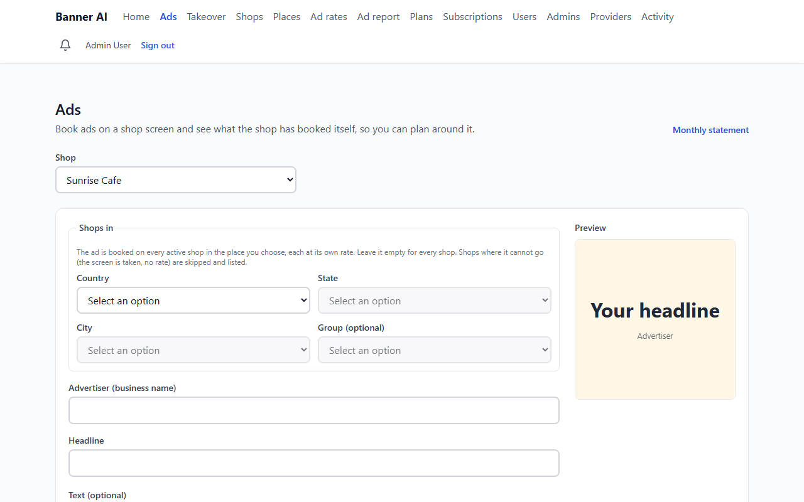

## Step 10. The compliance check (try it)
1. **Book an ad** for Sunrise Cafe with the headline `Call 9876543210 now`. It is **refused**: ads must not carry personal details.
2. Change it to `Free flu shots for every patient`, save it, send it in. It says it needs a **compliance review** and waits.
3. Open **Ads** again: the ad shows *Waiting for compliance review* with the reason. Click **Approve** (or **Send back** with a reason). **History** records who decided and when.

## Step 11. Money
Click **Ads → Monthly statement**. For each shop: hours every ad ran, and for your ads what the shop is **paid** (hours × price × share). Choose a month or one shop; the city totals show above.

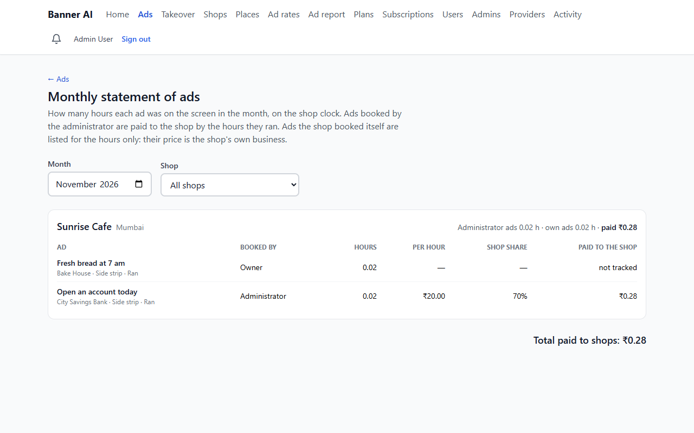

## Step 12. Who booked what
Click **Ad report**: for the month, how many ads each person booked, went live, were sent back or cancelled, are waiting, and how many were held for review.

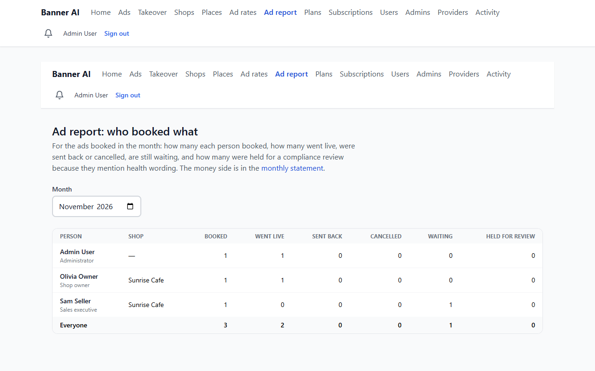

## Step 13. Takeovers
Click **Takeover**. When a shop changes hands the new owner asks and the old owner agrees. If the old owner cannot be reached you can **Confirm for the owner** with a written reason.
Be careful: the old shop's logins are switched off and its plan stops renewing.

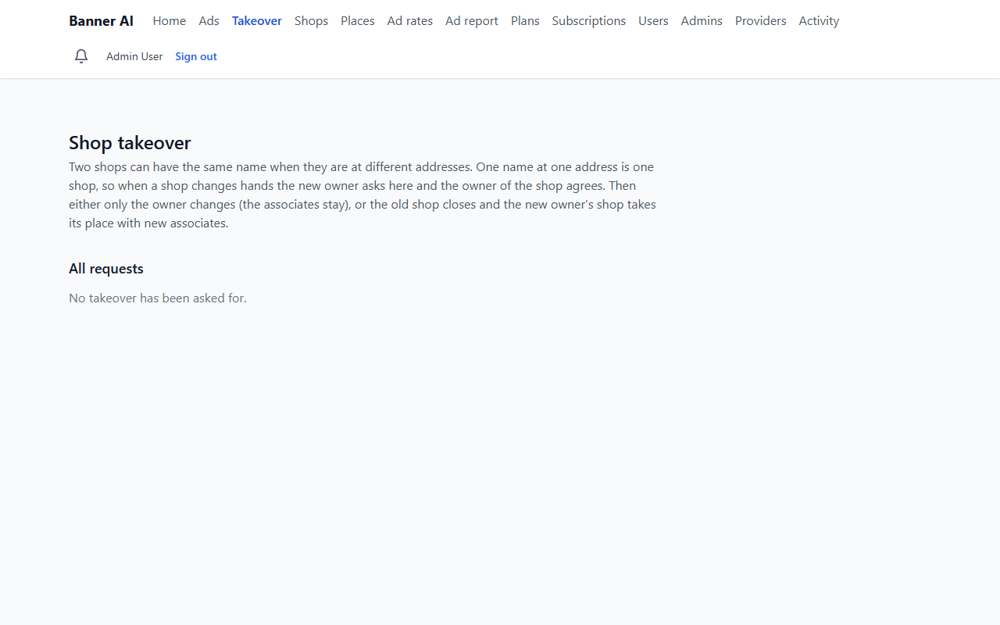

## Step 14. Activity and export
Click **Activity**: who called what, newest first. Filter by dates, user, shop or failures only. **Export as CSV** downloads the same entries (kept six years by default).

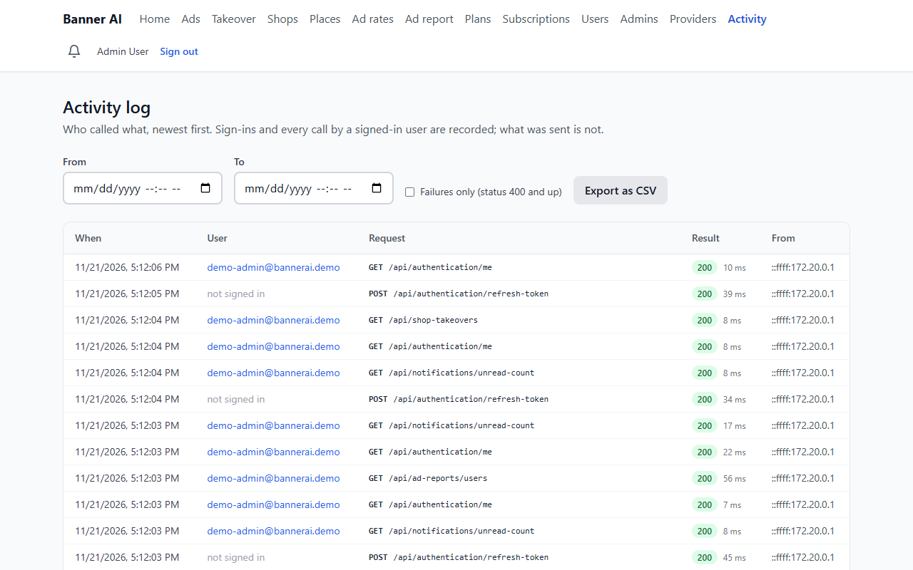

## Step 15. Messages
The bell tells you when an ad needs a review, when an owner overrides one of your ads, and when a shop changes hands.

---

## After the demo
- For real use, create your own administrator: `docker compose run --rm api --create-admin you@yourcompany.com "<a long password>"` and **do not run the demo script** on the real database.
- To go live, follow the [deployment guide](../../operations/deployment.md); [Providers setup guide](../../operations/providers-setup.md) covers connecting outside services.
- The full [Administrator Guide](../admin.md) has every detail.
